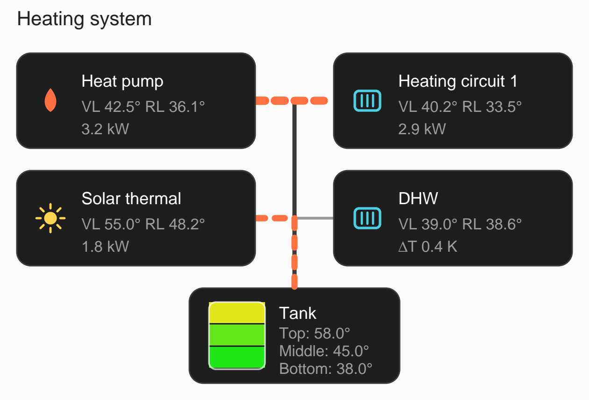

# Heating Flow Card

A Lovelace card for Home Assistant that visualizes heating systems – inspired by
power-flow-card-plus: clean boxes connected to a central bus line with animated
flows instead of cluttered diagrams.

The flow of a participant is derived from the **temperature difference** between
supply and return (`flow_temp` – `return_temp`). If a **pump signal** (`pump`)
is configured as well, its state decides whether a flow is shown at all, and
`pump_direction` defines the direction (towards the participant or away from it).

Supported participant types:

| Type | Meaning | Default flow direction |
|---|---|---|
| `generator` | Heat generator (heat pump, boiler, CHP …) | away from participant (`from`) |
| `solar` | Solar thermal | away from participant (`from`) |
| `emitter` | Heat consumers (heating circuit, DHW …) | towards participant (`to`) |
| `storage` | Layered tank with multiple temperature layers | charging = `to`, discharging = `from` (from temperature comparison) |



## Installation via HACS

1. Open HACS → **Frontend** (custom repositories) → top right **⋮ → Custom repository**
2. Enter `GruntMeister/HA-HeatingCard`, category **Lovelace**
3. Add it, then install **Heating Flow Card** in HACS and reload the frontend
   resources (dashboard → top right **⋮ → Refresh resources** / clear browser cache)

Manual installation: copy `heating-flow-card.js` to
`config/www/community/HA-HeatingCard/` and add it as a resource of type
**JavaScript module**.

## Configuration

```yaml
type: custom:heating-flow-card
title: Heating system
min_temp: 5        # temperature range for the color scale (optional, default 5)
max_temp: 80       # default 80
participants:
  - id: heatpump
    type: generator
    name: Heat pump
    sensors:
      flow_temp: sensor.hp_supply_temperature
      return_temp: sensor.hp_return_temperature
      power: sensor.hp_thermal_power          # optional, in kW
    pump: binary_sensor.hp_compressor       # optional
    pump_direction: from                    # to | from, defaults by type

  - id: solar
    type: solar
    name: Solar thermal
    sensors:
      flow_temp: sensor.solar_supply
      return_temp: sensor.solar_return
      power: sensor.solar_power
    pump: binary_sensor.solar_pump
    pump_direction: from

  - id: tank
    type: storage
    name: Tank
    layers:
      - name: Top
        temp: sensor.tank_top
      - name: Middle
        temp: sensor.tank_middle
      - name: Bottom
        temp: sensor.tank_bottom

  - id: heating_circuit_1
    type: emitter
    name: Heating circuit 1
    sensors:
      flow_temp: sensor.hc1_supply
      return_temp: sensor.hc1_return
      power: sensor.hc1_power
    pump: binary_sensor.hc1_pump
    pump_direction: to
```

### Card options

| Option | Type | Description |
|---|---|---|
| `title` | string | Optional card title |
| `min_temp` / `max_temp` | number | Temperature range of the color scale (blue → red) |
| `participants` | list | Participants of the system (required) |

### Participant options

| Option | Description |
|---|---|
| `id` | Unique ID |
| `type` | `generator`, `solar`, `emitter` or `storage` |
| `name` | Display name |
| `sensors.flow_temp` | Supply temperature of the participant |
| `sensors.return_temp` | Return temperature of the participant |
| `sensors.power` | Thermal power in kW (optional; controls flow width) |
| `pump` | Binary sensor/switch of the pump (optional). If set, only the pump signal counts |
| `pump_direction` | `to` (towards the participant) or `from` (away from it) |
| `direction` | Fixed flow direction when no pump is configured (default: `from` for generator/solar, `to` for emitter) |
| `threshold` | Minimum temperature difference for a flow without pump (default `0.5` K) |
| `layers` | `storage` only: list of `{ name, temp }` for the layers |

### Flow logic

- **With pump:** pump on → flow in direction `pump_direction`; pump off → no flow.
- **Without pump:** flow as soon as |supply – return| > `threshold`. Direction via `direction` or type default.
- **Storage:** compares the average layer temperature with the average supply temperature
  of the generators/solar. Bus warmer → charging (flow into the tank), storage warmer → discharging.

The width of the animated flow lines scales with power (kW) or temperature difference.
